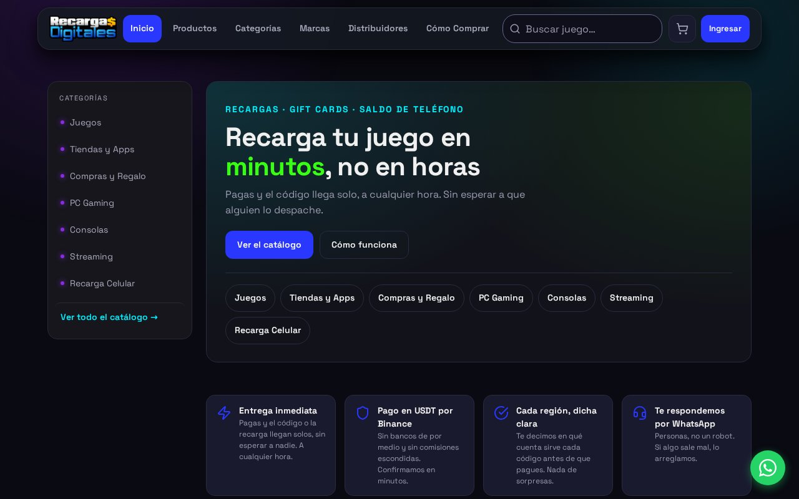
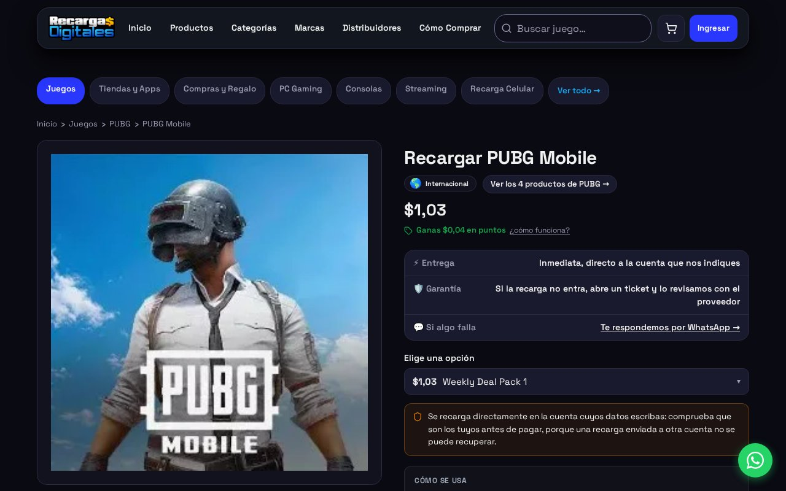
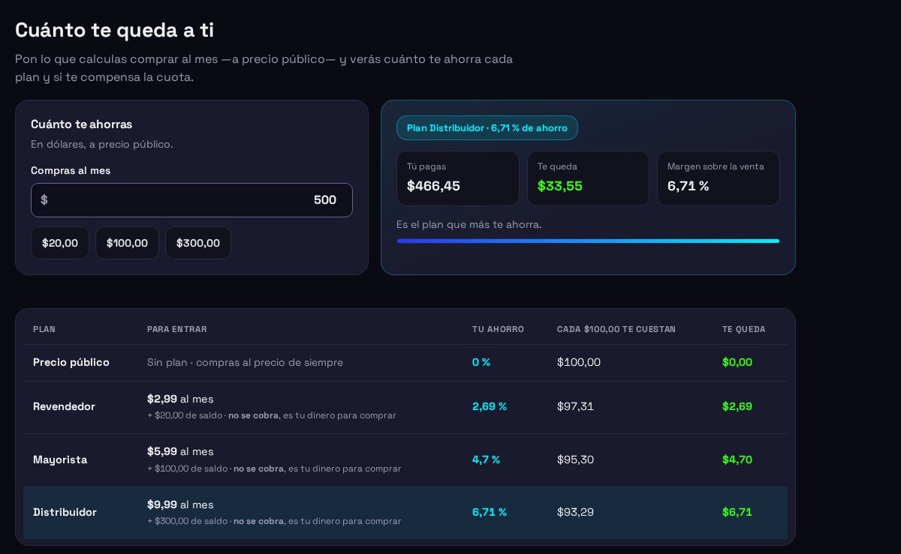
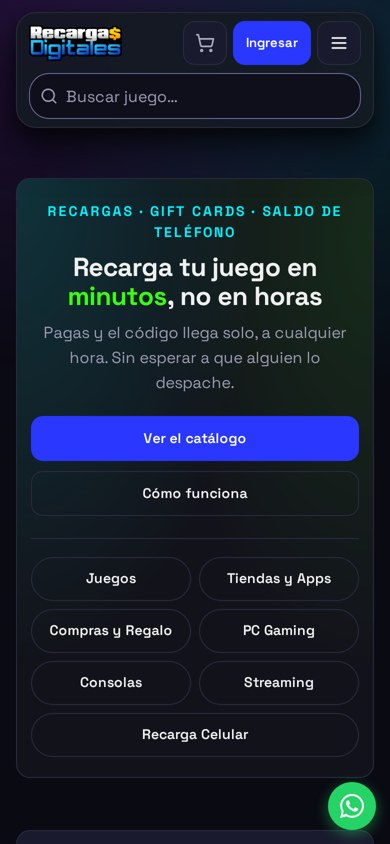
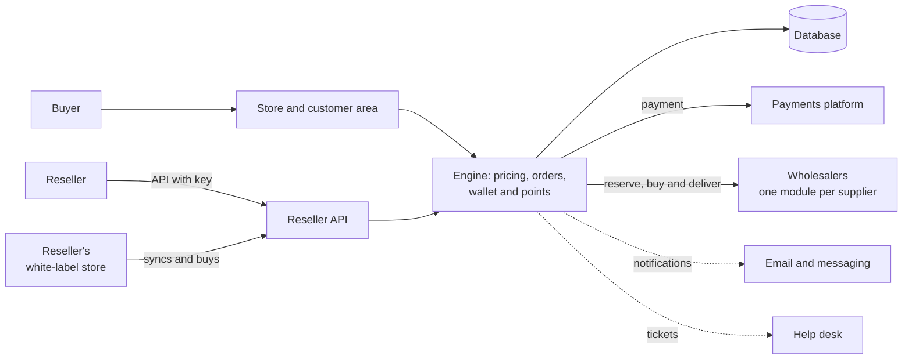

# Recargas Digitales

> A store for game top-ups, gift cards and mobile airtime for Latin America.
> The customer pays and the code or top-up arrives on its own, at any hour,
> with nobody dispatching it.

**Status:** in production at [recargasdigitales.com](https://recargasdigitales.com) ·
**Proprietary system** by Kusarive Solutions LLC ·
[Versión en español](README.md) ·
[Presentation page](https://rjblancos.github.io/recargasdigitales-showcase/) ·
**[Download the presentation as PDF](presentacion/RecargasDigitales-presentacion.pdf)** (16 slides, in Spanish)

---

## The problem

Buying a game top-up or a gift card from Latin America usually means messaging
someone, paying and waiting for a reply. Often the code turns out to belong to
another region and won't work on the buyer's account.

Recargas Digitales automates it end to end. The customer chooses a product and
sees, before paying, which region each code works in. Payment is in digital
dollars or in bolívars. The system buys from the wholesaler and delivers the
code or top-up within minutes, with its receipt.

## What it does

- **Catalog of 2,600 active denominations** across 314 products: games, stores
  and apps, gift cards, consoles, streaming and mobile airtime.
- **Automatic delivery.** Once payment is confirmed, the system reserves the
  order, buys from the wholesaler and delivers the code or the top-up straight
  to the player's account.
- **Region shown before paying.** Every product page states which account and
  which country the code works in, and search filters by region.
- **In-house pricing engine.** The sale price is derived from the wholesaler's
  real cost, by tiers and product families, with a margin and a minimum price
  that never lets a sale go through at a loss. It watches cost changes and
  raises alerts.
- **Two payment rails.** Digital dollars and bolívars through mobile transfer,
  both confirmed automatically.
- **Wallet and points.** A balance to buy without paying each order, and points
  computed on the margin, never on the amount.
- **Full customer area.** Orders, revealed codes, receipts, warranty and
  incident reports, balance, points and support.
- **Three reseller plans.** Wholesale prices across the whole catalog from the
  moment of signing up, accounts for the reseller's team, and a public
  calculator showing how much each plan saves.
- **Reseller API.** Catalog, price, order and balance, with a personal key, a
  test environment and public documentation. An external store is already
  selling the catalog through this API.
- **White-label store.** The top plan includes a complete store the reseller
  installs on their own hosting, with their brand, colors and prices. It syncs
  the catalog on its own and buys through the API.
- **Automatic identity verification** for plans and for purchases that require
  it, with a monthly spending cap until the customer is verified.
- **Built-in support.** Tickets reach the company's help desk, and delivery
  notifications go out by email and messaging.

## Benefits

| For the buyer | |
|---|---|
| **Receives within minutes, at any hour** | No waiting for someone to dispatch the order. |
| **Knows what they're buying** | Before paying, they see which region and account the code works for. |
| **Has someone to turn to** | Warranty and incident reports from their account, answered by people. |
| **Earns as they buy** | Points on every purchase and a balance in their wallet. |

| For the reseller | |
|---|---|
| **Wholesale prices without asking** | On signing up, the whole catalog shows with their discount. |
| **Sells under their own brand** | A white-label store, or an API integration with their own system. |
| **Knows what they earn** | A calculator shows how much each plan saves at their purchase volume. |

| For the operator | |
|---|---|
| **Never sells at a loss** | There is a minimum margin, computed on the wholesaler's real cost. |
| **Bounded fraud risk** | A block list at sign-up, at login and during the session, identity verification and per-customer caps. |
| **Swappable suppliers** | Each wholesaler lives in its own module, shaped like the others. One can be switched off without touching the store. |

## Screenshots

The interface is in Spanish.

| Home page | Product page |
|---|---|
|  |  |

| Reseller calculator | On mobile |
|---|---|
|  |  |

## Architecture

The purchase from the wholesaler happens outside the database transaction. The
order is first reserved, then bought and finally delivered. That way a slow
wholesaler never leaves the store blocked.

## Technical guarantees

| Area | What the system guarantees |
|---|---|
| **Pricing** | No sale below a minimum margin over the wholesaler's real cost, including its fee and its issuing currency. |
| **Delivery** | Every order is reserved before it is bought, and the purchase happens outside the transaction, so a slow wholesaler never blocks the store. |
| **Fraud** | Block list, identity verification, monthly caps and sensitive products only for verified customers. |
| **Quality** | **More than 70 test suites** before every deployment, written to fail when something breaks, plus real-browser tests across 17 screen widths. |
| **Data** | Numbered migrations applied in order and only once. Supplier keys live in the database, not in files. |

## Built with

| Language | Where | Approximate size |
|---|---|---|
| **PHP** | The store, customer area, admin panel, API and engine | 56,000 lines |
| **PHP** | Operations tools and the test suites | 27,000 lines |
| **PHP** | The white-label store | 10,000 lines |
| **SQL** | The schema and 72 migrations | 4,000 lines |
| **CSS and JavaScript** | The interface and the browser tests | 10,000 lines |
| **Python** | Checks against production | 1,000 lines |

GitHub's language bar only measures the files in this repository, which is
documentation.

## Results

Real production figures as of 27-Oct-2026:

- **2,600 distinct top-ups and cards** on sale, across 314 products.
- **202 brands in 39 regions** and 7 categories.
- **More than 13,000 wholesale products** mapped, with their cost and delivery
  method, ready to be added to the catalog.
- **Automatic delivery around the clock**, with no human involvement.

## Contact

Rafael Blanco, for Kusarive Solutions LLC

- Web: [recargasdigitales.com](https://recargasdigitales.com)
- Email: info@recargasdigitales.com
- WhatsApp: [+58 412 896 2261](https://wa.me/584128962261)
- Presentation: [16-slide PDF](presentacion/RecargasDigitales-presentacion.pdf) (in Spanish)

© 2026 Kusarive Solutions LLC. See [LICENSE](LICENSE).
