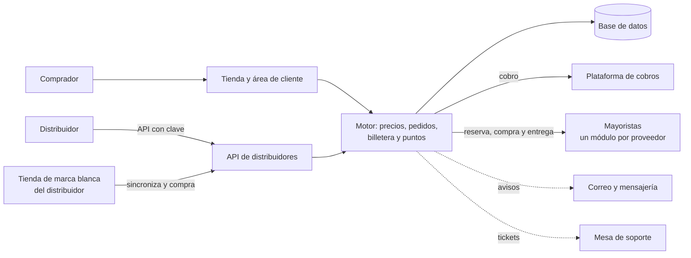

# Recargas Digitales

> Tienda de recargas de juegos, tarjetas de regalo y saldo de teléfono para
> América Latina. El cliente paga y el código o la recarga le llega solo, a
> cualquier hora, sin que nadie lo despache.

**Estado:** en producción en [recargasdigitales.com](https://recargasdigitales.com) ·
**Sistema propietario** de Kusarive Solutions LLC ·
[English version](README.en.md) ·
[Página de presentación](https://rjblancos.github.io/recargasdigitales-showcase/)

---

## Qué resuelve

Comprar una recarga de un juego o una tarjeta de regalo desde América Latina suele
significar escribir a alguien, pagar y esperar a que conteste. Muchas veces el
código resulta ser de otra región y no entra en la cuenta del comprador.

Recargas Digitales lo automatiza de punta a punta. El cliente elige, ve en qué
región sirve cada código antes de pagar y paga en dólar digital o en bolívares.
El sistema compra al mayorista y le entrega el código o la recarga en minutos,
con su comprobante.

## Qué hace

- **Catálogo de 2.600 denominaciones activas** en 314 productos: juegos,
  tiendas y apps, tarjetas de regalo, consolas, streaming y saldo de teléfono.
- **Entrega automática.** Al confirmarse el pago, el sistema reserva el pedido,
  compra al mayorista y entrega el código o la recarga directa en la cuenta del
  jugador.
- **Región dicha antes de pagar.** Cada ficha indica en qué cuenta y en qué
  país funciona el código, y la búsqueda filtra por región.
- **Motor de precios propio.** Del coste real del mayorista sale el precio de
  venta, por tramos y familias de producto, con margen y un precio mínimo que
  nunca deja vender a pérdida. Vigila los cambios de coste y avisa.
- **Dos vías de pago.** Dólar digital y bolívares por pago móvil, ambas con
  confirmación automática.
- **Billetera y puntos.** Saldo para comprar sin pagar cada pedido, y puntos que
  se calculan sobre el margen, nunca sobre el importe.
- **Área de cliente completa.** Pedidos, códigos revelados, comprobantes,
  garantía e incidencias, saldo, puntos y soporte.
- **Tres planes de distribuidor.** Precios mayoristas en todo el catálogo desde
  el momento de contratar, cuentas para el equipo del distribuidor y una
  calculadora pública de cuánto ahorra cada plan.
- **API para distribuidores.** Catálogo, precio, pedido y saldo, con clave
  propia, entorno de pruebas y documentación pública. Ya hay una tienda externa
  vendiendo el catálogo por esta API.
- **Tienda de marca blanca.** El plan superior incluye una tienda completa que
  el distribuidor instala en su propio hosting, con su marca, sus colores y sus
  precios. Se sincroniza sola con el catálogo y compra por la API.
- **Verificación de identidad automática** para los planes y para las compras
  que la exigen, con un tope mensual de compra hasta que el cliente se verifica.
- **Soporte integrado.** Los tickets llegan a la mesa de soporte de la empresa,
  y los avisos de entrega se envían por correo y por mensajería.

## Beneficios

| Para el comprador | |
|---|---|
| **Recibe en minutos, a cualquier hora** | No espera a que nadie despache su pedido. |
| **Sabe lo que compra** | Antes de pagar ve en qué región y en qué cuenta sirve el código. |
| **Tiene a quién reclamar** | Garantía e incidencias desde su cuenta, con respuesta de personas. |
| **Gana al comprar** | Puntos en cada compra y saldo en su billetera. |

| Para el distribuidor | |
|---|---|
| **Precio mayorista sin pedir nada** | Al contratar, todo el catálogo se le muestra con su descuento. |
| **Vende con su propia marca** | Tienda de marca blanca o integración por API con su sistema. |
| **Sabe lo que gana** | Una calculadora le dice cuánto ahorra cada plan con su volumen de compra. |

| Para el operador | |
|---|---|
| **Nunca vende a pérdida** | Hay un margen mínimo, calculado sobre el coste real del mayorista. |
| **Riesgo de fraude acotado** | Lista de veto en el alta, en la entrada y en la sesión, verificación de identidad y topes por cliente. |
| **Proveedores intercambiables** | Cada mayorista vive en su propio módulo, con la misma forma que los demás. Se puede apagar uno sin tocar la tienda. |

## Capturas

| Portada | Ficha de producto |
|---|---|
|  |  |

| Calculadora de distribuidores | En el móvil |
|---|---|
|  |  |

## Arquitectura

La compra al mayorista se hace fuera de la transacción de la base de datos. El
pedido primero se reserva, después se compra y por último se entrega. Así un
mayorista lento nunca deja la tienda bloqueada.

## Garantías técnicas

| Área | Qué garantiza el sistema |
|---|---|
| **Precio** | Ninguna venta por debajo de un margen mínimo sobre el coste real del mayorista, con su comisión y su moneda de emisión. |
| **Entrega** | Cada pedido se reserva antes de comprarse y la compra se hace fuera de la transacción, así que un mayorista lento no bloquea la tienda. |
| **Fraude** | Lista de veto, verificación de identidad, topes mensuales y productos sensibles solo para clientes verificados. |
| **Calidad** | **Más de 70 baterías de pruebas** antes de cada despliegue, escritas para ponerse rojas, más pruebas con navegador real en 17 anchos de pantalla. |
| **Datos** | Migraciones numeradas que se aplican en orden y una sola vez. Las claves de los proveedores viven en la base de datos, no en ficheros. |

## Construido con

| Lenguaje | Dónde | Tamaño aproximado |
|---|---|---|
| **PHP** | La tienda, el área de cliente, el panel, la API y el motor | 56.000 líneas |
| **PHP** | Herramientas de operación y las baterías de pruebas | 27.000 líneas |
| **PHP** | La tienda de marca blanca | 10.000 líneas |
| **SQL** | El esquema y 72 migraciones | 4.000 líneas |
| **CSS y JavaScript** | La interfaz y las pruebas con navegador | 10.000 líneas |
| **Python** | Comprobaciones contra producción | 1.000 líneas |

La barra de lenguajes de GitHub mide solo los ficheros de este repositorio, que
es documentación.

## Resultados

Cifras reales leídas de la base de datos de producción el 27-oct-2026:

- **2.600 denominaciones activas** en 314 productos.
- **119 pedidos entregados** desde la apertura, el 12-sep-2026, sin contar
  cuentas internas.
- **59 clientes** con al menos un pedido entregado.

## Contacto

Rafael Blanco, para Kusarive Solutions LLC

- Web: [recargasdigitales.com](https://recargasdigitales.com)
- Correo: info@recargasdigitales.com
- WhatsApp: [+58 412 896 2261](https://wa.me/584128962261)

© 2026 Kusarive Solutions LLC. Ver [LICENSE](LICENSE).
